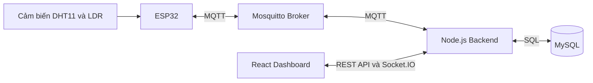

# Hệ thống Smart Room IoT

Smart Room là hệ thống giám sát nhiệt độ, độ ẩm và ánh sáng, đồng thời cho phép điều khiển thiết bị mô phỏng từ Dashboard Web. ESP32 đọc cảm biến và nhận lệnh qua MQTT; Backend lưu dữ liệu vào MySQL, cung cấp REST API và gửi cập nhật thời gian thực đến giao diện React.

## Kiến trúc



- **ESP32** đọc cảm biến, xử lý chế độ Auto/Manual, điều khiển LED và gửi trạng thái thực tế.
- **MQTT Broker** chuyển tiếp số đo, cấu hình ngưỡng, lệnh và phản hồi giữa ESP32 với Backend.
- **Backend** dùng Express, MQTT.js, Socket.IO và MySQL để cung cấp API, lưu lịch sử và phát sự kiện realtime.
- **Frontend** dùng React và Vite để hiển thị Dashboard, biểu đồ, bảng lịch sử và các điều khiển.

## Chức năng

- Đăng nhập bằng tài khoản cấu hình trong Backend.
- Theo dõi số đo và trạng thái kết nối thiết bị trên Dashboard; biểu đồ cập nhật khi có mẫu mới.
- Tra cứu dữ liệu cảm biến và lịch sử điều khiển với tìm kiếm, lọc, sắp xếp và phân trang.
- Chuyển hệ thống giữa Auto và Manual; bật/tắt riêng từng LED và xem kết quả phản hồi từ ESP32.
- Thay đổi ngưỡng cảnh báo; cấu hình được lưu trong MySQL và đồng bộ đến ESP32 qua MQTT. Các ngưỡng điều khiển Auto mặc định được thiết lập trong firmware.
- Xem trạng thái đèn cảnh báo cùng thống kê và danh sách thời điểm cảnh báo đã kích hoạt.

## Phần cứng và ngưỡng điều khiển

Mô hình sử dụng ESP32, cảm biến DHT11 để đo nhiệt độ/độ ẩm, cảm biến ánh sáng LM393/LDR đọc qua ngõ analog, ba LED mô phỏng thiết bị và ba LED cảnh báo riêng.

Ở chế độ Auto, các ngưỡng điều khiển mặc định trong firmware là:

| Điều kiện đo | Thiết bị mô phỏng |
| --- | --- |
| Nhiệt độ > 30 °C | LED 01, mô phỏng quạt |
| Độ ẩm > 68% | LED 02, mô phỏng điều hòa |
| Ánh sáng < 100 | LED 03, mô phỏng đèn |

Chế độ Manual cho phép người dùng điều khiển ba LED từ Dashboard. Ngưỡng Auto và ngưỡng cảnh báo là hai nhóm cấu hình riêng.

## Cảnh báo ba cảm biến

ESP32 so sánh mỗi mẫu đo với ngưỡng cảnh báo tương ứng trong cả hai chế độ Auto và Manual. Mỗi cảm biến có một LED cảnh báo riêng; LED nhấp nháy khi giá trị vượt ngưỡng và tắt khi điều kiện cảnh báo kết thúc.

| Cảm biến | Điều kiện cảnh báo | Ngưỡng mặc định | LED cảnh báo |
| --- | --- | --- | --- |
| Nhiệt độ | Giá trị đo > ngưỡng | 30 °C | GPIO 26 |
| Độ ẩm | Giá trị đo > ngưỡng | 68% | GPIO 27 |
| Ánh sáng | Giá trị đã quy đổi > ngưỡng | 900 trên thang 0–1000 | GPIO 25 |

Ngưỡng có thể chỉnh trên Dashboard. Backend kiểm tra giới hạn hợp lệ, lưu cấu hình vào `system_settings` rồi gửi bản tin MQTT retained để ESP32 nhận lại sau khi kết nối lại. Trạng thái từng LED được gửi realtime lên Dashboard; mỗi lần cảnh báo bắt đầu sẽ được ghi nhận để thống kê theo ngày/tháng.

**Lưu ý về ánh sáng:** firmware ánh xạ số đọc ADC từ 0–4095 sang thang 1000–0. Giá trị này chưa được hiệu chuẩn thành lux, vì vậy ngưỡng 900 là giá trị tương đối của mô hình, không phải 900 lux.

## Phần mềm

- ESP32 firmware: C/C++ với Arduino IDE; thư viện WiFi, DHT, PubSubClient và ArduinoJson.
- Backend: Node.js, Express, MQTT.js, Socket.IO và `mysql2`.
- Frontend: React, Vite, Chart.js và Socket.IO Client.
- Cơ sở dữ liệu: MySQL, lưu tài khoản, thiết bị, cảm biến, số đo, lịch sử điều khiển, cấu hình và thời điểm cảnh báo.

## Chạy dự án

### 1. Cài dependency

```sh
cd frontend
npm ci

cd ../backend
npm ci
```

### 2. Cấu hình dịch vụ

Từ thư mục `backend`, sao chép `.env.example` thành `.env` rồi điền JWT secret, tài khoản quản trị, thông tin MySQL và MQTT Broker. Dùng một JWT secret ngẫu nhiên dài ít nhất 32 byte. Giữ xác minh chứng chỉ TLS bật, trừ khi đang kết nối tới broker self-signed mà bạn tin cậy.

Khởi tạo database `smart_room` theo thiết kế cơ sở dữ liệu của báo cáo, bảo đảm có bản ghi `system_settings` với `id = 1`, sau đó chạy các migration trong `backend/migrations` theo thứ tự `001` đến `004`.

### 3. Chạy Backend và Frontend

```sh
cd backend
npm start
```

Lệnh `npm start` build frontend trước và chạy Backend ở cổng `4000` theo mặc định. Để phát triển giao diện, giữ Backend đang chạy rồi mở terminal khác:

```sh
cd frontend
npm run dev
```

Vite chạy ở cổng `5173` và chuyển tiếp API/Socket.IO đến Backend cổng `4000`. Có thể đổi cổng Backend bằng biến `PORT`.

### 4. ESP32 và Postman

- Sao chép `secrets.example.h` thành `secrets.h`, điền Wi-Fi và MQTT của bạn rồi đặt hai file cạnh sketch trong Arduino IDE. `secrets.h` không được đưa vào Git.
- Firmware mẫu nằm trong `code_IoT.txt`; chép nội dung vào sketch Arduino nếu cần mở bằng IDE.
- Bộ sưu tập API nằm trong `postman/`. Điền `adminUsername` và `adminPassword` theo `backend/.env`, gửi request đăng nhập để lấy JWT rồi gọi các API còn lại.

## Giới hạn của mô hình

LED được dùng để mô phỏng thiết bị chấp hành; muốn điều khiển quạt, điều hòa hoặc đèn thật cần bổ sung mạch công suất và bảo vệ phù hợp. Cảm biến ánh sáng chưa được hiệu chuẩn theo lux. Báo cáo cũng chưa đánh giá đầy đủ sai số cảm biến và khả năng vận hành liên tục.

Không commit file `.env`, `secrets.h` hoặc thông tin đăng nhập thật.
